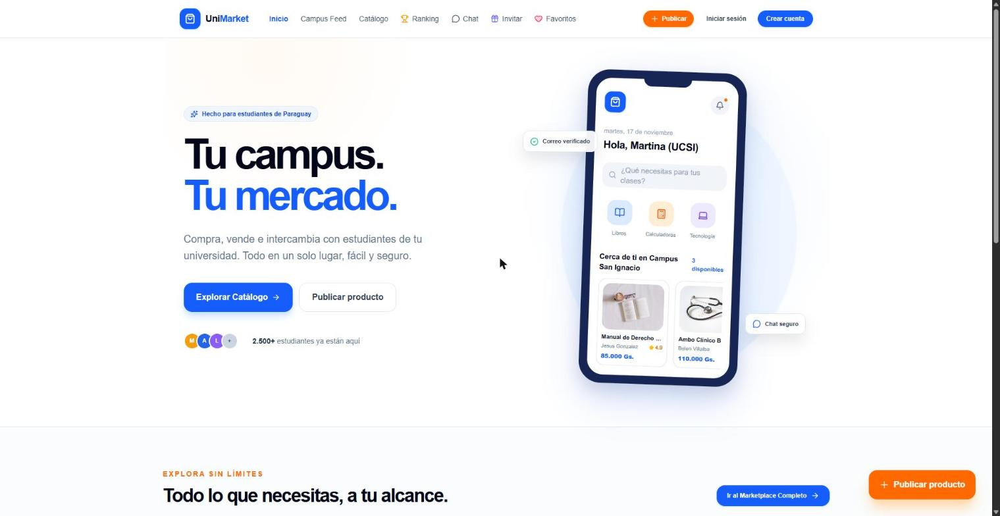

<div align="center">

# 🛍️ UniMarket

**Tu campus. Tu mercado.**

El marketplace universitario de Paraguay: los estudiantes compran, venden e intercambian
libros, tecnología, apuntes y más, dentro de su propio campus.

[](https://unimarket-development.vercel.app)




</div>

---

## Sobre el proyecto

**UniMarket** conecta a estudiantes de una misma universidad para que puedan comprar y vender
entre ellos de forma simple y segura. Nació para la comunidad de la Universidad Católica,
Campus San Ignacio (UCSI), y está pensado para extenderse a otras universidades del país.

## Funcionalidades

### Marketplace
- 🛒 **Catálogo** por categorías y **búsqueda** de productos.
- 📸 **Publicación** de productos con varias imágenes.
- ❤️ **Favoritos** para guardar productos.
- 🔁 **Operaciones**: seguimiento de compras, ventas e intercambios.

### Comunidad
- 💬 **Chat** entre comprador y vendedor, con contador de no leídos y marcado de mensajes leídos.
- 🔔 **Notificaciones** de actividad.
- ⭐ **Reseñas** a vendedores y **ranking** de los mejor valorados.
- 👤 **Perfiles públicos** de cada estudiante.
- 🎁 **Invitaciones** para sumar compañeros.

### Seguridad
- ✅ **Registro** con validación del correo electrónico.
- 🚫 **Bloqueo de usuarios** y **reportes** de publicaciones.
- 🔐 Autenticación y datos gestionados con Supabase.

### Experiencia
- 📱 **PWA instalable**, con íconos y manifiesto para móvil.
- 🎨 Interfaz con componentes accesibles (shadcn/ui · Base UI).

## Tecnologías

| Capa | Tecnología |
|---|---|
| Framework | Next.js (App Router) · React · TypeScript |
| Estilos y UI | Tailwind CSS · shadcn/ui · Base UI · Lucide |
| Datos | Supabase (PostgreSQL · Auth) |
| Formularios | React Hook Form · Zod |
| Analítica | Vercel Analytics |
| Hosting | Vercel |

## Estructura

```
app/
├── inicio · productos · producto/[id] · buscar     # Catálogo y búsqueda
├── publicar · operaciones · favoritos              # Gestión de productos
├── mensajes · notificaciones                       # Comunicación
├── perfil · perfil/[id] · ranking · invitar        # Comunidad
└── registro                                        # Alta de usuarios
components/                                         # Componentes de UI reutilizables
lib/supabase/                                       # Cliente de Supabase
scripts/                                            # Migración de esquema e íconos de la PWA
```

Tablas principales: `profiles`, `listings`, `listing_images`, `favorites`, `conversations`,
`messages`, `operations`, `reviews`, `blocked_users`, `reports`.

## Cómo ejecutarlo

**Requisitos:** Node.js 20+, pnpm y un proyecto de Supabase.

```bash
git clone https://github.com/Zephixd/unimarket.git
cd unimarket
pnpm install
```

Crear `.env.local` en la raíz:

```env
NEXT_PUBLIC_SUPABASE_URL=https://<tu-proyecto>.supabase.co
NEXT_PUBLIC_SUPABASE_ANON_KEY=<clave-anon>
```

```bash
pnpm dev        # http://localhost:3000
```

El script `scripts/upgrade_schema.js` aplica cambios de esquema y lee la conexión desde la
variable `DATABASE_URL`.

## Autor

**Mathias Sebastian Britos Griffith** — *GreenKnow*
Estudiante de Ingeniería Informática · Universidad Católica «Nuestra Señora de la Asunción», Unidad Pedagógica San Ignacio Guazú

[](https://greenknow-portfolio.vercel.app)
[](https://github.com/Zephixd)
